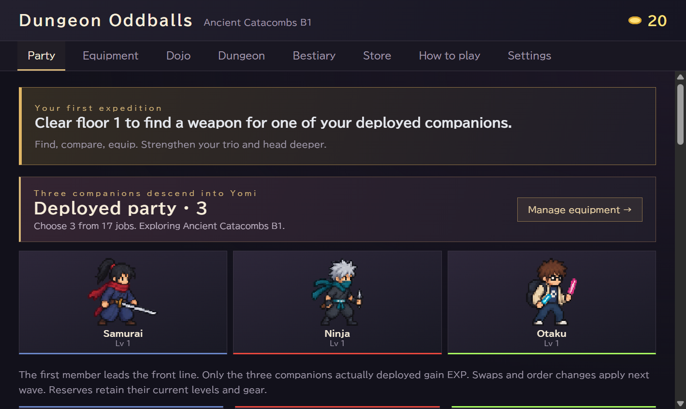

# Dungeon Oddballs (working title)

[日本語](README.md) · [Game specification](docs/GAME_SPEC.md) · [Technical specification](docs/TECH_SPEC.md)

A Japanese folklore idle RPG about choosing three companions from a roster of 17, descending into a dungeon, and finding equipment. On Windows, battles run just above the taskbar while a separate panel handles your party, equipment, and attributes. The browser edition shares the same game core and provides a portrait layout for phones.

Normal and Nightmare each have 100 floors. Only the highest difficulty, Abyss, continues without a gameplay floor limit. Future updates are intended to introduce dungeons with different themes and separate progress. The first launch follows your OS or browser language, choosing Japanese or English. You can override it in Settings.

The current dungeon cycles through three regions, twelve enemy types and three major bosses. Abyss goals mark B100, 250, 500 and 1000, then every 1000 floors. An expedition journal records the three companions, allocated attributes and gear names used for those clears.

Version 0.7.5 connects equipment requirements to a training goal and back to the same comparison. Party swaps show changes in healing and protection, bosses preview their first-clear reward, and recovery farming shows progress with a manual retry option. [Changes and validation (Japanese)](docs/reviews/2026-11-01-quality-loop-resolution.md).




[17 companion profiles (Japanese)](docs/CHARACTERS.md) · [Enemies and combat specification (Japanese)](docs/GAME_SPEC.md) · [Playing on a phone (Japanese)](docs/MOBILE.md)

[Catacombs](docs/images/background-catacombs.png) · [Market](docs/images/background-market.png) · [Archive](docs/images/background-archive.png) · [Combat motion](docs/images/action-frames.png)

These are captures of the game's own windows. Current character and enemy artwork uses AI-generated transparent PNGs; provenance and prompts are recorded in [Credits](docs/CREDITS.md). See [HANDOFF](HANDOFF.md) for verification results and remaining acceptance checks. Detailed project documents are currently written in Japanese.

## Playing

- Use the Dungeon screen to compare each area's equipment tendencies and travel to a nearby unlocked floor. After a wipe, review the three companions who fought, adjust your formation or armor, and retry. Travel requested during combat shows its destination and takes effect at the next wave.

- Only the three companions actually fighting gain experience. Reserves retain their existing levels and equipment, but gain no experience. Party changes take effect at the next wave. Previously earned levels are preserved.
- Combine attackers, tanks, healers, buffers, and debuffers. The roster includes Samurai, Ninja, Jirai Girl, Otaku, Pachinko Pro, Shrine Maiden, Bancho, Gyaru, Sukeban, Farmer, Maid, Jiangshi, Vagabond, Sumo Wrestler, Sister, Goofy Lord, and Bookworm.
- Allocate STR, DEX, VIT, and INT manually or automatically. Reset allocations for free. Equipment requires suitable jobs and attributes, with no character-level requirement.
- Find weapons, armor, and charms with random base values and modifiers, including Mythic equipment for specialized builds.
- Extreme and Legendary weapons may carry an engraving that improves skill power or duration at the cost of a longer cooldown. Comparisons explain both sides, and useful upgrades appear first.
- Preview roles, combinations, and deployed catch-up experience before changing your party. Later bosses cycle attack patterns; at each hundred-floor milestone, their skill changes below half HP.
- Your first floor clear awards a usable weapon for an active companion. First clears of every tenth floor award Epic or better gear; floor 100 awards Legendary or better gear. Compare actual stat changes before equipping. Gear strength continues across difficulty boundaries.
- Read boss warnings and targets, then adjust your party. Sumo Wrestler can interrupt casts; Maid follows marked targets, Sukeban punishes slowed enemies, and Bancho counters harder while warded.
- Fight ten waves per floor. Every tenth floor ends with a boss; other final waves contain elites. Find treasure and altars, return to town, revisit unlocked floors, or farm a floor repeatedly.
- Compare, equip, lock, and sell gear, configure automatic equipment and selling, train at the dojo, and read the 12-enemy codex and in-game help.
- On Windows, hover over a companion for details and click to open the panel. Use the system tray to pause, hide the battle strip, or quit. Closing the panel keeps the game running. Notification sounds are off by default. Enable them in Settings for short cues at rare finds and major milestones.

## Running locally

On Windows, double-click [start-dev.bat](start-dev.bat) to launch the development edition through the same launcher as `pnpm dev`. Keep its console open and quit through the game's system tray menu. Development saves remain separate from production saves. Missing Node.js or dependencies produce an explanation without installing anything automatically.

The Windows development environment uses Node.js 24 and pnpm 10.

```powershell
pnpm install
pnpm dev
```

For the browser edition:

```powershell
pnpm web:dev
# http://127.0.0.1:5174/mobile/
pnpm web:build
pnpm web:preview
# http://127.0.0.1:4174/
```

See [Mobile and browser setup](docs/MOBILE.md) for connecting a phone on the same network. Windows user saves, development saves, and browser saves are separate. Closing the browser stops simulation; offline rewards are calculated when you return. This is a web entry point, not a native background app for iOS or Android.

## Saves and the store

Windows saves automatically every 30 seconds, after floor clears and commands, and when quitting. Recovering a damaged save from its previous valid version requires confirmation explaining that later progress may be lost. Recovery starts paused; choosing Exit leaves the original files unchanged. Unsupported future formats and unrecoverable files stop startup without resetting progress. Save formats v1 and v2 migrate to v3.

A failed save pauses progression and displays recovery actions. On Windows, retry saving or export the current progress to another location. If saving still fails when quitting, choose to return to the game, export, or explicitly exit without saving. Progress is never silently discarded by that dialog.

Import an exported JSON file from Settings using **Choose a save file**. Review its date, floor and three companions before explicitly replacing your progress. Restoration starts paused and keeps your settings. A browser save that cannot load can also be restored from the error screen; this recovery resets settings to OS-language defaults. Saves from a newer version cannot be overwritten.

Version 0.7.1 doubles the combat, movement and between-wave pace again compared with 0.7.0. Play time and income per minute still use real elapsed time.

Browser saves stay in the current browser and site. Storage failures and conflicting updates from another tab stop progression. Export before reloading; there is no automatic overwrite retry for a tab conflict. Clearing site data also removes its save. Cloud saves are available through the separate service described below.

The store previews cosmetic ground themes without changing combat or rewards. Real purchases and Steam Market are unavailable in normal builds. Explicitly isolated development builds support test purchases. Live Steam integration still requires contracts, application IDs, a trusted service, ownership synchronization, and acceptance checks. Local equipment does not become a Steam trading item. See [Commerce](docs/COMMERCE.md).

## Cloud saves in v0.6

Open Cloud saves in Settings to create an account, log in, manually save or load progress, or log out. Usernames contain 3–32 lowercase letters, digits or underscores; passwords contain 12–256 characters. The game does not persist passwords or session tokens. Sign in again after restarting the app or browser.

If another device has saved first, the server rejects the stale revision rather than replacing the newer save. Loading shows the selected revision and asks for confirmation before replacing local progress; the restored game starts paused. Export your local save in Settings first if you want to retain it. An upload with an unknown result is never retried automatically. Use Check status to verify what the server saved before proceeding.

The service lives in the separate repository `C:\00_PG\40_game_test_server`. Development starts with `http://127.0.0.1:8787` as its server address; start the server process separately. Override the Windows endpoint using `GAME_CLOUD_URL` at startup, or the browser endpoint using `VITE_CLOUD_URL` during development/build. Specify a server origin. A production build with no endpoint clearly shows that cloud saves are disconnected and remains playable with local saves. Remote servers require HTTPS. The service has not been publicly deployed or accepted for production operation.

## Local verification and distribution

Run checks locally. GitHub Actions must not be used for this project.

```powershell
pnpm typecheck
pnpm lint
pnpm test
pnpm build
pnpm test:shell
node tools/shell-check.mjs --visual
pnpm sim -- --progress --minutes 120 --seed 1
pnpm dist
pnpm release:check
```

The Windows x64 portable is generated at `release/TaskbarHyakkiko-<version>-portable.exe`. [Release preparation](docs/RELEASE.md) separates build success, file audits, actual executable use, clean-machine checks, signing, and Steam acceptance. Signing, Steam registration, and live sales have not been completed.

## Project layout and documents

| Location | Purpose |
|---|---|
| [GAME_SPEC](docs/GAME_SPEC.md) | Gameplay and product decisions |
| [TECH_SPEC](docs/TECH_SPEC.md) | Architecture, storage, input boundaries, and verification |
| [CHARACTERS](docs/CHARACTERS.md) / [IP](docs/IP.md) | Original character proposals and asset management |
| [CREDITS](docs/CREDITS.md) | Artwork, fonts, and generation records |
| `src/core/` | Platform-independent combat, progression, loot, and dungeons |
| `src/main/` | Windows shell, tray, saves, and host loop |
| `src/commerce/` | Product catalog, orders, and receipt verification |
| `src/shared/` | API contracts, validation, character identities, and translations |
| `src/renderer/` | Battle strip, management panel, mobile layout, and browser adapter |
| `assets/sprites/art/` | Adopted artwork for 17 companions and 12 enemies, with prompts |
| `tools/` / `tests/` | Local checks, packaging, simulator, and tests |

[AGENTS](AGENTS.md) contains project rules. [HANDOFF](HANDOFF.md) records current work and how to resume. [DESIGN](docs/DESIGN.md) and `docs/design/` preserve early design history; GAME_SPEC and TECH_SPEC describe the current product.
