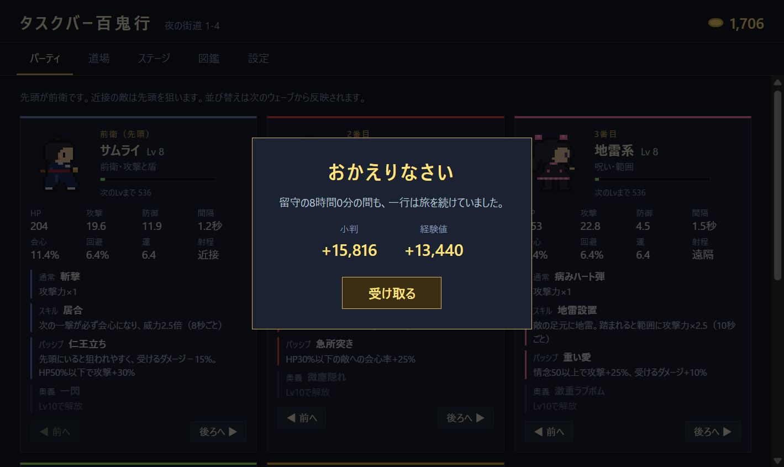
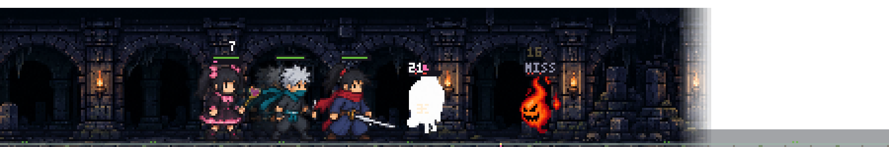

# Taskbar Hyakkiko (working title)

[日本語](README.md) · [Game specification](docs/GAME_SPEC.md) · [Technical specification](docs/TECH_SPEC.md)

A Japanese folklore idle RPG about choosing three companions from a roster of 17, descending into a dungeon, and finding equipment. On Windows, battles run just above the taskbar while a separate panel handles your party, equipment, and attributes. The browser edition shares the same game core and provides a portrait layout for phones.

Normal and Nightmare each have 100 floors. Only the highest difficulty, Abyss, continues without a gameplay floor limit. Future updates are intended to introduce dungeons with different themes and separate progress. Switch between Japanese and English using the language button or Settings.





[All 17 companions](docs/images/characters.png) · [12 enemies](docs/images/enemies.png) · [English phone layout](docs/images/mobile-en.png)

[Catacombs](docs/images/background-catacombs.png) · [Market](docs/images/background-market.png) · [Archive](docs/images/background-archive.png) · [Combat motion](docs/images/action-frames.png)

These are captures of the game's own windows. Current character and enemy artwork uses AI-generated transparent PNGs; provenance and prompts are recorded in [Credits](docs/CREDITS.md). See [HANDOFF](HANDOFF.md) for verification results and remaining acceptance checks. Detailed project documents are currently written in Japanese.

## Playing

- Only the three companions actually fighting gain experience. Reserves retain their existing levels and equipment, but gain no experience. Party changes take effect at the next wave. Previously earned levels are preserved.
- Combine attackers, tanks, healers, buffers, and debuffers. The roster includes Samurai, Ninja, Jirai Girl, Otaku, Pachinko Pro, Shrine Maiden, Bancho, Gyaru, Sukeban, Farmer, Maid, Jiangshi, Vagabond, Sumo Wrestler, Sister, Goofy Lord, and Bookworm.
- Allocate STR, DEX, VIT, and INT manually or automatically. Reset allocations for free. Equipment requires suitable jobs and attributes, with no character-level requirement.
- Find weapons, armor, and charms with random base values and modifiers, including Mythic equipment for specialized builds.
- Fight ten waves per floor. Every tenth floor ends with a boss; other final waves contain elites. Find treasure and altars, return to town, revisit unlocked floors, or farm a floor repeatedly.
- Compare, equip, lock, and sell gear, configure automatic equipment and selling, train at the dojo, and read the 12-enemy codex and in-game help.
- On Windows, hover over a companion for details and click to open the panel. Use the system tray to pause, hide the battle strip, or quit. Closing the panel keeps the game running. There is currently no sound.

## Running locally

The Windows development environment uses Node.js 24 and pnpm 10.

```powershell
pnpm install
pnpm dev
```

For the browser edition:

```powershell
pnpm web:dev
# http://127.0.0.1:5174/mobile/
pnpm web:build
pnpm web:preview
# http://127.0.0.1:4174/
```

See [Mobile and browser setup](docs/MOBILE.md) for connecting a phone on the same network. Windows user saves, development saves, and browser saves are separate. Closing the browser stops simulation; offline rewards are calculated when you return. This is a web entry point, not a native background app for iOS or Android.

## Saves and the store

Windows saves automatically every 30 seconds, after floor clears and commands, and when quitting. It can recover from the previous valid save. Unsupported future formats and unrecoverable files stop startup without resetting progress. Save formats v1 and v2 migrate to v3.

A failed save pauses progression and displays recovery actions. On Windows, retry saving or export the current progress to another location. If saving still fails when quitting, choose to return to the game, export, or explicitly exit without saving. Progress is never silently discarded by that dialog.

Browser saves stay in the current browser and site. Storage failures and conflicting updates from another tab stop progression. Export before reloading; there is no automatic overwrite retry for a tab conflict. Clearing site data also removes its save. Import and cloud sync are not currently provided.

The store previews cosmetic ground themes without changing combat or rewards. Real purchases and Steam Market are unavailable in normal builds. Explicitly isolated development builds support test purchases. Live Steam integration still requires contracts, application IDs, a trusted service, ownership synchronization, and acceptance checks. Local equipment does not become a Steam trading item. See [Commerce](docs/COMMERCE.md).

## Local verification and distribution

Run checks locally. GitHub Actions must not be used for this project.

```powershell
pnpm typecheck
pnpm lint
pnpm test
pnpm build
pnpm test:shell
node tools/shell-check.mjs --visual
pnpm sim -- --progress --minutes 120 --seed 1
pnpm dist
pnpm release:check
```

The Windows x64 portable is generated at `release/TaskbarHyakkiko-<version>-portable.exe`. [Release preparation](docs/RELEASE.md) separates build success, file audits, actual executable use, clean-machine checks, signing, and Steam acceptance. Signing, Steam registration, and live sales have not been completed.

## Project layout and documents

| Location | Purpose |
|---|---|
| [GAME_SPEC](docs/GAME_SPEC.md) | Gameplay and product decisions |
| [TECH_SPEC](docs/TECH_SPEC.md) | Architecture, storage, input boundaries, and verification |
| [CHARACTERS](docs/CHARACTERS.md) / [IP](docs/IP.md) | Original character proposals and asset management |
| [CREDITS](docs/CREDITS.md) | Artwork, fonts, and generation records |
| `src/core/` | Platform-independent combat, progression, loot, and dungeons |
| `src/main/` | Windows shell, tray, saves, and host loop |
| `src/commerce/` | Product catalog, orders, and receipt verification |
| `src/shared/` | API contracts, validation, character identities, and translations |
| `src/renderer/` | Battle strip, management panel, mobile layout, and browser adapter |
| `assets/sprites/art/` | Adopted artwork for 17 companions and 12 enemies, with prompts |
| `tools/` / `tests/` | Local checks, packaging, simulator, and tests |

[AGENTS](AGENTS.md) contains project rules. [HANDOFF](HANDOFF.md) records current work and how to resume. [DESIGN](docs/DESIGN.md) and `docs/design/` preserve early design history; GAME_SPEC and TECH_SPEC describe the current product.
