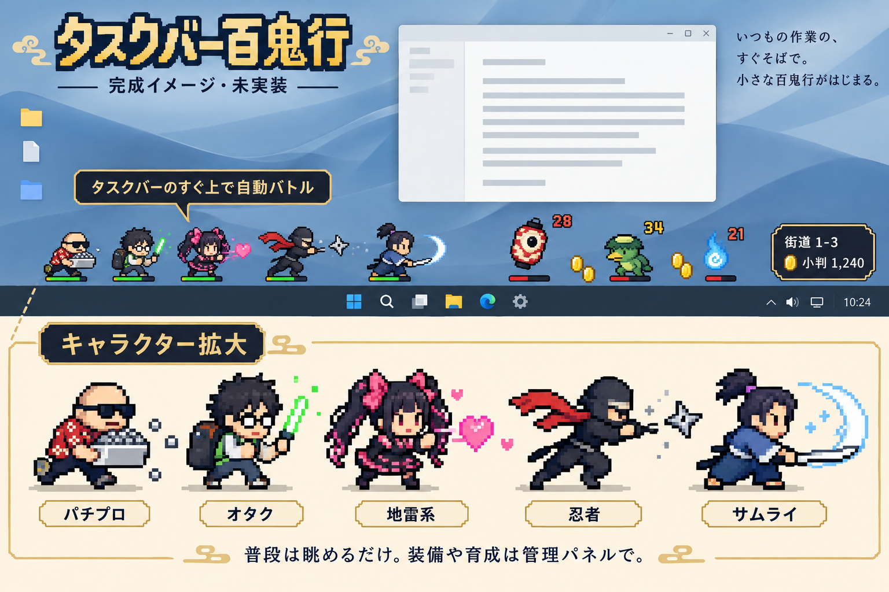
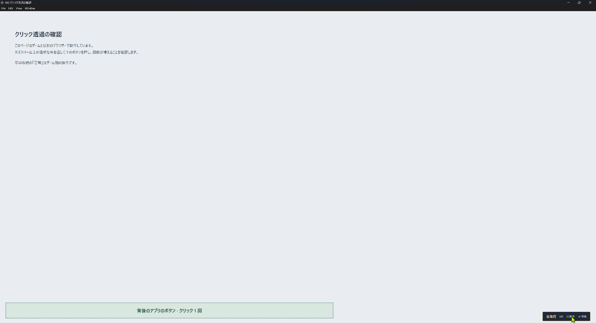

# タスクバー百鬼行（仮題）

GitHub（非公開）：[benybeny777/40_game_test](https://github.com/benybeny777/40_game_test)

Windowsのタスクバー直上で5人の和風パーティが冒険する、2D・ドット絵の放置RPGを作るプロジェクトです。

現在は **M0の透明な帯・トレイと、M1の画面なしの戦闘コア** まで実装しています。透過クリックは実画面で確認し、トレイメニューの処理と正常終了は実Electronを使う検証を用意しました。キャラが動く画面はM2、スキルはM3、セーブと育成はM4以降です。まだ画面で遊べる状態ではありません。

## 画面イメージ



**設計を説明するAI生成の完成イメージです。現在動くゲーム画面ではありません。** 上段は作業中のデスクトップとタスクバー直上の自動バトル、下段は5人のキャラクターの拡大図です。キャラの大きさ・UI・絵柄は仮で、実装時に調整します。

左からパチプロ（玉で攻撃）、オタク（回復・応援）、地雷系（ハートや呪術）、忍者（手裏剣）、サムライ（前衛の刀）。普段は透明な帯の中で自動的に進み、妖怪を倒して経験値・小判・装備を集め、ときどき管理パネルで育成するゲームを目指します。

<details>
<summary>現在のM0実画面（土台のみ）</summary>


`pnpm dev` で起動した帯の右端の実画面です（2026-10-20）。黒い部分は背後のアプリが透けて見えています。現在はこの管理ボタンだけで、キャラクターや戦闘はまだありません。

</details>

## 画面なしで戦闘を試す（M1）

```powershell
pnpm sim -- --stage 1 --minutes 10
pnpm sim -- --stage 5 --minutes 120 --seed 1 --lv 1 --json
```

5ジョブの通常攻撃とエリア1の雑魚3種で、指定したステージを固定Lv・装備なしで周回します。1分ごとの統計と合計、与ダメ・自動回復の割合、SnapshotのSHA-256を出します。同じseedと条件なら結果を再現できます。実行には既存のNode.jsのTypeScript実行機能を使い、新しい依存は追加していません。

ステージは通し番号1〜5。**現在はLv1のみ**です。成長式の食い違いが未決定のため、`--lv 2`以上は説明付きでエラーにします。ボス・スキル・経験値によるLv上昇・装備・ドロップ生成・`--progress`は未実装です。M1の10ウェーブ目は雑魚の護衛2体だけで、ボス込みの難易度ではありません。小判・経験値は診断用の集計で、利用者のセーブには保存しません。

## 起動

対象はWindows 11。Node.js 24、pnpm 10を使用します。

```powershell
pnpm install
pnpm dev
```

初回のinstallでは、このプロジェクト用のElectronランタイムを取得します。依存は固定版と`pnpm-lock.yaml`で管理します。`pnpm dev` はViteのホットリロードとmain/preloadの再ビルド・再起動に対応します。

- 初期配置はプライマリーモニターの作業領域下端、タスクバーの直上（高さ96 DIP）。タスクバーが自動で隠れる環境は画面下端。モニター構成や作業領域が変わると再配置します。
- 帯は透明・枠なし・最前面。通常はクリックを透過し、右端の「管理」ボタン上だけ入力を受け付けます。右クリックで簡易メニューを開きます。
- トレイの「管理パネルを開く」「帯を隠す／帯を表示」「一時停止／再開」「終了」で操作します。トレイが隠れている場合はWindowsの通知領域を開いてください。一時停止はM0では状態表示だけです。
- 管理パネルを閉じても常駐します。アプリ全体はトレイの「終了」で終了します。2回目の起動は新しい帯を作らず管理パネルを開きます。
- セーブ処理は未実装。開発時のChromiumデータも含めて`.dev-data/`に隔離し、利用者用の保存先と混ぜません。パスの正本は`src/main/paths.ts`です。

## 検証

```powershell
pnpm typecheck
pnpm lint
pnpm test
pnpm build
pnpm test:shell
```

型チェック・ESLint・Vitest 21件・ビルドは成功。コアは10分間の全Snapshotのハッシュ一致、計算式、回避・会心・最小ダメージ、ウェーブ／ステージ／全滅の遷移を確認しています。ESLintでコア内の`Math.random`・`Date`・Node/Electron依存・計算係数の直書きを禁止しています。

M0は最前面の不具合を修正し、透明部分の背後アプリへの実クリック（0→1）、帯ボタンでのパネル表示とCSSを確認しました。`pnpm test:shell`は実際のTrayに接続したMenu項目をプログラムから実行し、表示／非表示・一時停止／再開・パネルの開閉と「終了」を確認します。終了コード0、プロジェクトのElectron本体・子プロセスが0件になることを確認済みです。**通知領域のアイコンをマウスで開いて終了する操作、帯の右クリック、別モニターの抜き差しは実操作確認が残ります。** 検証用メニューは表示できましたが、画面ツールのDPI・メニュー操作の制約で終了の実クリックを確定できていません。詳細と相談事項はHANDOFF.mdを参照してください。

<details>
<summary>M0：帯の透明部分を通した実クリックの確認画像</summary>



</details>

クリック透過を確認する際は`tools/click-through.html`を別のブラウザーで開き、最大化して下端のボタンを押すと回数で判断できます。これは手動検証用のページで、ゲームに組み込む画面ではありません。

`pnpm build`はローカルの`out/`に実行用ファイルを作ります。`test:shell`にはビルド済みのファイルとWindowsのデスクトップが必要です。配布用exe・`pnpm dist`はM7で実装します。GitHub Actionsは使用しません。

## 構成

言語はTypeScript、デスクトップの土台はElectron、開発・ビルドはVite（electron-vite）です。帯はCanvas 2Dと仮のDOMボタン、管理パネルはHTML/CSS。M0はシステムフォントを使用します。

| 場所 | 役割 |
|---|---|
| AGENTS.md | 作業ルールの正本 |
| HANDOFF.md | 進行状況・再開手順・未確認事項 |
| docs/DESIGN.md | 仕様とマイルストーン |
| docs/design/ | M1〜M7の詳細設計（型・計算式・画面・受入条件） |
| docs/CREDITS.md | 素材・フォント・画像の出典 |
| src/main/ | ウィンドウ・配置・トレイ・保存先 |
| src/core/ | Electron・DOM・Node入出力に依存しない戦闘コアと数値データ |
| tools/sim-runner.ts | 画面なしの固定Lvシミュレーションと統計 |
| src/preload/、src/shared/ | sandbox対応の型付きAPI・IPC定義 |
| src/renderer/ | 帯と仮の管理パネル |
| tests/ | コアの受入、配置、開発／利用者プロファイル分離のテスト |

作業再開時はAGENTS.md → HANDOFF.md → README.md → docs/DESIGN.md → docs/design/README.mdの順に読みます。
