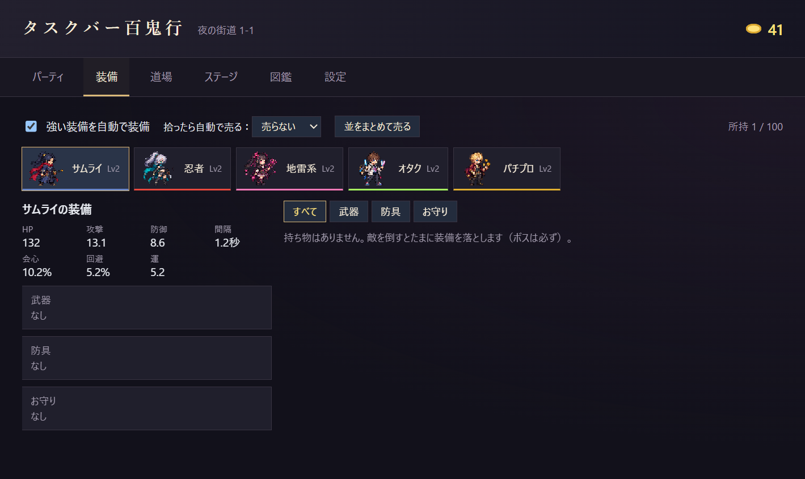

# タスクバー百鬼行（仮題）

GitHub（非公開）：[benybeny777/40_game_test](https://github.com/benybeny777/40_game_test)

Windowsのタスクバー直上で5人の和風パーティが冒険する、2D・ドット絵の放置RPGです。

現在は **5人の自動戦闘・育成・装備収集と、3エリア15ステージ**を実装しています。各ステージの10ウェーブ目はボスです。2026-10-27に5ジョブと妖怪12体の画像を刷新し、帯と管理画面の両方へ組み込みました。配布用exeの構成はありますが、配布・受入確認はまだ行っていません。

## 実際の画面


ゲーム自身のウィンドウだけを撮った実画面です（2026-10-27、表示倍率150%）。画像の背景部分は透明で、実際には後ろのアプリが見えます。




<details>
<summary>完成イメージ（設計時のAI生成画像）</summary>


設計を説明するためのAI生成画像です。実際の画面とは絵柄や大きさが違います。

</details>

## 遊び方

対象はWindows 11。Node.js 24、pnpm 10を使用します。

```powershell
pnpm install
pnpm dev
```

- タスクバーのすぐ上の透明な帯で、パーティが歩いて妖怪と戦います。操作しなくても進みます。透明な部分はクリックがすり抜けるので、普段どおり作業できます。
- **キャラにマウスを乗せる**と、Lv・HP・スキルの残り時間が出ます。**クリック**すると管理パネルが開きます（右端の小判の枠はステージ画面、敵は図鑑）。右クリックで簡易メニューが開きます。
- **管理パネル**：パーティ（5人の一覧・能力・スキル・隊列）、装備（武器・防具・お守りの比較／装着／ロック／売却、自動装備、自動売却）、道場、ステージ、図鑑、設定。
- **ジョブ**：サムライ（居合・仁王立ち・一閃）、忍者（影分身・急所突き・微塵隠れ）、地雷系（地雷設置・情念ゲージ・激重ラブボム）、オタク（差し入れで回復・推しへの愛・全力応援）、パチプロ（確変チャレンジ・期待値計算・大当たり）。スキルは最初から、パッシブはLv5、奥義はLv10で解放されます。
- 3回続けて全滅すると、ひとつ前のステージで鍛え直してから自動で再挑戦します。夜の街道→シャッター商店街→電脳街へ進み、3-5のクリア後は3-5を周回します。
- 一時停止・帯の表示切り替え・終了は、タスクトレイのアイコンから行います。パネルを閉じても常駐します。2回目の起動はパネルを開きます。
- **セーブ**は30秒ごと・ステージクリア・パネル操作・終了時に自動で行います。直近の稼ぎの半分をオフライン報酬として受け取れます（基本8時間、道場で最大16時間）。オフライン装備は10分ごとに1個。セーブv1は装備対応のv2へ移行します。
- **全画面アプリ中は帯を隠す**設定を追加。Windowsの前面ウィンドウの大きさと通知状態を監視します。全画面の検知と設定OFF時の復帰は実機確認済み。全画面を閉じた後の自動復帰は、この環境では前面ウィンドウを検証用画面へ切り替えられず未確認です。
- 開発用（`pnpm dev`）のセーブと設定は `.dev-data/` に、配布版は利用者のAppDataに分かれます。パスの正本は `src/main/paths.ts` です。開発時だけ、環境変数 `GAME_SPEED`（1〜50）で早送りできます。
- 音は鳴りません。

進み方の目安（2026-10-27、新規セーブ・seed 1・道場を自動購入するシミュレーター）：1-1が2.0分、1-5が32.5分、2-5が83.8分。120分で3-1を解放、ドロップ54個（うち装備中15個）。実機で120分連続プレイした結果ではありません。

## 検証

```powershell
pnpm typecheck; pnpm lint; pnpm test; pnpm build
pnpm test:shell                                 # 実際のトレイメニューで表示・一時停止・パネル・終了を確認
node tools/shell-check.mjs --visual             # 帯とパネルの全タブを、ゲームのウィンドウだけ撮影して .dev-data/preview へ
node tools/shell-check.mjs --fullscreen         # 実Windowsの全画面検知。前面を移せない環境ではPARTIALと報告
pnpm sim -- --progress --minutes 120 --seed 1   # 新規セーブから遊んだ場合の進み方
pnpm sim -- --stage 3 --minutes 10 --lv 10      # 固定Lvで1ステージを周回
pnpm sprites:preview                            # 元のテキスト製素材（弾・アイコン等）を確認。現行キャラは--visualで確認
```

型チェック・ESLint・Vitest 66件・ビルド・`test:shell`・`--visual` が成功しています（2026-10-27）。シェル検証は `.dev-data/verification/` に隔離し、通常の開発セーブを変更しません。テストで確認している内容は次のとおりです。

- 戦闘の再現性と計算式
- スキル：居合、差し入れ、激重ラブボム、確変の上限、奥義の解放、ボスの金棒振り
- 育成と進行：Lvアップ、道場、オフライン報酬、自動の鍛え直し
- セーブの保存と、壊れたセーブからの復旧
- スプライトの形式
- 装備・所持上限・自動装備・オフライン装備・ID重複防止・セーブv1移行
- エリア2／3の敵、分裂・召喚・幻影・自爆、全画面の判定

**未確認**：通知領域アイコンの実マウス操作、帯の右クリック、別モニター・100%表示、30分以上の実機負荷、全画面終了後の自動復帰、3-5までの通しプレイ、配布用exe。GitHub Actionsは使用しません。

<details>
<summary>M0：帯の透明部分を通した実クリックの確認画像</summary>


</details>

クリック透過を手で確かめるときは、`tools/click-through.html` を別のブラウザーで開いて最大化し、下端のボタンを押してください。回数が増えれば透過しています。

## 構成

言語はTypeScript、デスクトップの土台はElectron、開発・ビルドはVite（electron-vite）です。帯はCanvas 2Dで、1ドットを整数の物理ピクセルで描きます。管理パネルはHTML/CSSで、依存なしのDOMです。文字はWindowsのシステムフォントと、自作の3×5ドット文字を使っています。

| 場所 | 役割 |
|---|---|
| AGENTS.md | 作業ルールの正本 |
| HANDOFF.md | 進行状況・再開手順・未確認事項 |
| docs/DESIGN.md | 仕様とマイルストーン |
| docs/design/ | M1〜M7の詳細設計（型・計算式・画面・受入条件） |
| docs/CREDITS.md | 素材・フォント・画像の出典 |
| src/core/ | Electron・DOM・Node入出力に依存しない戦闘・スキル・育成と数値データ |
| src/main/ | ウィンドウ・配置・トレイ・ゲームループ・セーブ |
| src/preload/、src/shared/ | sandbox対応の型付きAPI・IPC定義・入力の検証 |
| src/renderer/ | 帯（描画・演出・ツールチップ）と管理パネル |
| assets/sprites/art/ | 現行の透過キャラ／妖怪アトラスと生成指示（PROMPTS.md） |
| assets/sprites/src/ | 弾・アイコンと旧テキスト製素材。現行キャラ／妖怪の描画はartのPNGを使用 |
| tools/ | シミュレーター、スプライトの確認、実画面の検証スクリプト |
| tests/ | コア・スキル・育成・セーブ・配置・スプライトのテスト |

作業を再開するときは AGENTS.md → HANDOFF.md → README.md → docs/DESIGN.md → docs/design/README.md の順に読みます。
