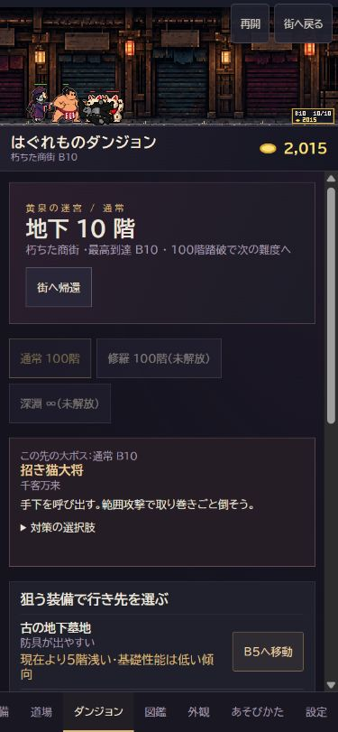

# v0.7.4 爽快感の改善と検証

利用者の「さらにやれ」「爽快感あるように」に対応。攻撃を待つ時間、命中した手応え、戦闘を覆う文字を見直した。

## 改善

- 停止した遠隔敵へ近接隊列が前進する。接近中の敵は迎撃し、前後間隔を保つ。攻撃の準備中に標的が倒されたら、通常射程内で狙い直す。
- 会心の局所的な金色の火花、とどめの45msの白い衝撃＋315msの吹き飛びを追加。画面全体を白くする演出は局所斬撃へ変更。カメラ・地面・数字・装備・撃破残像が隊列の前進に追従する。
- 通常技能、自動売却、ハズレの表示を抑え、連携と装備獲得を区別。ボス予兆を優先しつつ、拾った装備は次の戦闘でも読める。
- 戦闘座標、カメラ、撃破演出、通知抑制を別の責務へ分離。期限切れの通知履歴を破棄し、長時間放置でも蓄積しない。

## レビューと修正

実Claude CLIの初回指摘（致死攻撃のflash欠落、狙い直した敵と突進先の不一致、売却の成果通知化）を修正。[Claude再審査](2026-11-01-claude-action-final.md)は新たな具体欠陥なし。[Codex最終審査](2026-11-01-codex-action-final.md)の履歴増大も修正し、コード統合承認。両者のコード審査を実プレイ評価とは混同しない。

## 検証

- 型・lint、68ファイル747テスト成功。最後の通知履歴削除1行の追加後は関連3テスト・lintを再実行して成功し、Web/Windows配布を再ビルドした。
- [9編成×3seedの60分比較](2026-11-01-party-balance-audit.md)。近接3人の初回B1は39–45分から0.61–0.68分へ、最大無打撃は74–87秒から1.7–2.2秒へ短縮。これはゲーム本体の測定で、人間の実プレイではない。
- Codex右IABの実プレイは初期Lv1・無装備の番長/力士/キョンシー。編集した強化値なし。道場の攻撃/HPを各1段購入。10分24.95秒でB10、撃破328、ボス撃破2、全滅1。B10大ボスでの敗北を含め、成功だけを選別していない。UI書き出しは `.dev-data/action-melee-play-final.json`。
- 最後の描画修正を含むWebビルドへ再読込後、戦闘の前進、白い命中、数字、標的への攻撃、戦闘継続、設定/ダンジョン移動、一時停止、書き出しを操作。375×812 CSS px、横はみ出しなし、console error/warn 0。短い45msの厳密な長さは単体検証による。最初から全時間を最終描画版で遊んだとは扱わない。
- 右画面はB10一時停止。viewport指定は解除。表示用4177 previewを維持。新しい外部ブラウザーやWindowsゲーム画面は起動していない。

全680組の編成・長時間深淵・実ユーザーの楽しさ評価・新版Windows exeの実起動は今回の証明対象外。Steam等の外部手続きは利用者の指示どおり対象外。ソース・自動検証・右画面操作の結果をそれぞれ分けて残す。

配布116ファイル検査成功。現行portableは120,869,399 bytes、SHA256 dde938aecd3762aefc8f687e3066f11f258a60cb3af49feef5210b129de54264、未署名。旧0.7.3 portableは新版検査後、絶対パス・非リンク・非使用を確認して削除し、消失を確認。削除後Cドライブ空き453,455,351,808 bytes。保護されたフォント・既知の削除拒否対象は再試行せず保持。
